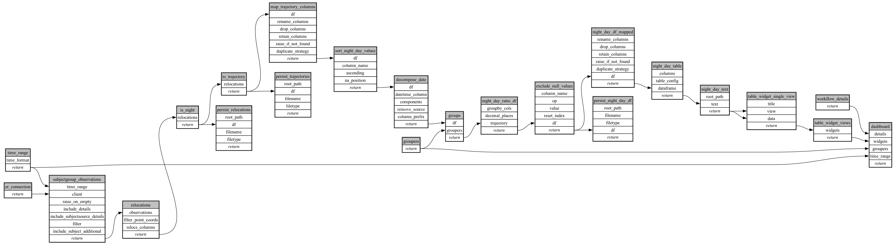

```
# AUTOGENERATED BY ECOSCOPE-WORKFLOWS; see fingerprint in README.md for details

```

```yaml
# fingerprint:
artifacts_sha256_basic: 86a420170fcab2da42d5dde51d30d7846d7c238e6d8f7740ab597c7124c3679c
artifacts_sha256_strict: fdfec8050add7898dde239a72e03a86102da89dff895923f5bc1bef938d08672
installed_requirements:
- channel: https://repo.prefix.dev/ecoscope-workflows/
  name: ecoscope-platform
  version: {version: ==2.25.3}
- channel: https://repo.prefix.dev/ecoscope-workflows-custom/
  name: ecoscope-workflows-ext-custom
  version: {version: ==0.1.5}
- channel: https://repo.prefix.dev/ecoscope-workflows-custom/
  name: ecoscope-workflows-ext-ste
  version: {version: ==0.0.24}
- channel: conda-forge
  name: pydeck
  version: {version: ==0.9.2}
params_sha256: b755f5e5876df8d41174a71f06ec2bfe4dc81f299c097946eaae271e1cf25ad6
spec_sha256: c45b8ce352f5eb0e4887a5fcbf4dd6c3a3425810fc9eb8193390af5f394efe33

```

# ecoscope-workflows-subject-night-day-table-workflow


